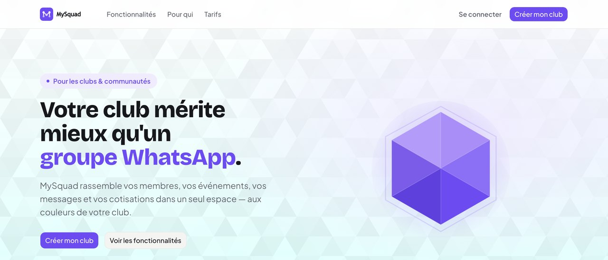
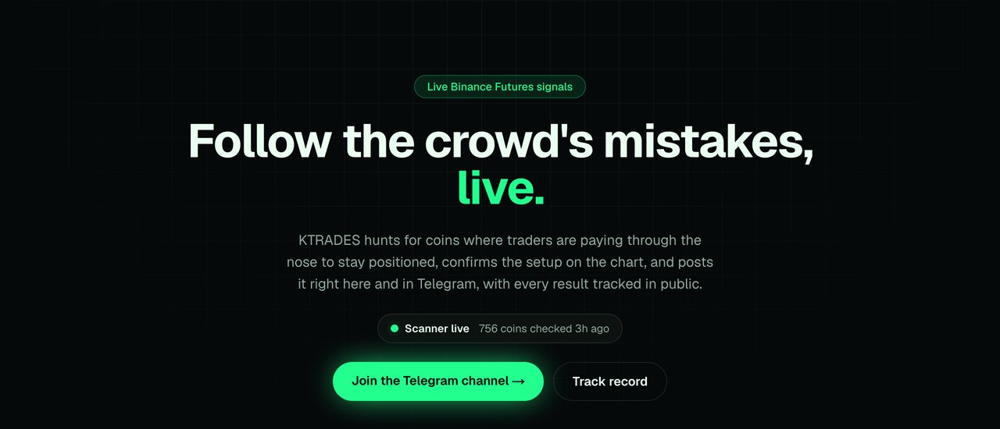

<h1 align="center">Hi 👋, I'm KHALIL HAIMER</h1>
<h3 align="center">Full-stack developer · 42 Network student</h3>

I build web products end to end, from the database to the UI, and ship them live.

  
  

## 🚀 Featured projects

<table>
  <tr>
    <td width="50%" valign="top">
      
      <h3><a href="https://mysquad.tech">MySquad</a></h3>
      
One space for sports clubs and communities: members, events, messages and dues, in the club's own colours. Every club gets its own subdomain, <code>yourclub.mysquad.tech</code>.

      <ul>
        <li>Feed, events with one-tap RSVP, group chats and DMs</li>
        <li>Match results, scorers and assists for sports clubs</li>
        <li>Dues tracking, member profiles, in-app and email notifications</li>
        <li>Multi-tenant: each club's data is isolated by Postgres Row-Level Security</li>
        <li>Installable PWA, in French and Arabic</li>
      </ul>
      

        
        
        
        
        
      

      
<a href="https://mysquad.tech"><b>Visit mysquad.tech →</b></a>

    </td>
    <td width="50%" valign="top">
      
      <h3><a href="https://ktrades-signals.vercel.app">KTRADES Signals</a></h3>
      
Every 30 minutes it scans all Binance USDT futures for coins with extreme funding rates, confirms the setup on the chart, and posts the trade (entry, take-profit, stop-loss) to Telegram.

      <ul>
        <li>Python scanner and chart analysis behind a Flask API</li>
        <li>Public track record: every trade is followed to the end and scored after fees and funding, losses included</li>
        <li>Telegram alerts when a trade opens and again when it closes</li>
        <li>Next.js live board, with scans triggered by a GitHub Actions cron</li>
      </ul>
      

        
        
        
        
        
        
      

      
<a href="https://ktrades-signals.vercel.app"><b>Live site →</b></a> · <a href="https://t.me/KTradesSignals">Telegram</a> · <a href="https://github.com/THE-Bandersnatch/ktrades-signals">Code</a>

      Not financial advice.
    </td>
  </tr>
</table>

## 🎓 42 projects

| Project | What it's about | Stack |
| :--- | :--- | :--- |
| [libft](https://github.com/THE-Bandersnatch/42-libft-2022-10) | My own C library: libc functions rewritten from scratch (strings, memory, conversions) plus linked-list helpers | C |
| [get_next_line](https://github.com/THE-Bandersnatch/Get_next_line.c) | Returns a file one line at a time from a file descriptor; the bonus reads from several at once | C |
| [ft_printf](https://github.com/THE-Bandersnatch/1337-ft_printf) | My own `printf`, handling `%c %s %p %d %i %u %x %X %%` | C |
| [Born2beRoot](https://github.com/THE-Bandersnatch/Born2beRoot) | A secured Linux server in a virtual machine: encrypted LVM partitions, SSH, firewall, strict sudo and password rules, and a monitoring script | Linux |
| [push_swap](https://github.com/THE-Bandersnatch/Push-Swap) | Sorts numbers using two stacks and a limited set of moves, in as few moves as possible, plus a checker program (bonus) | C |
| [minitalk](https://github.com/THE-Bandersnatch/Minitalk) | A client and a server that exchange messages using only UNIX signals | C |
| [so_long](https://github.com/THE-Bandersnatch/so_long-2D-game-) | A small 2D game: collect every item, then reach the exit, on maps read from files and validated | C · MiniLibX |
| [philosophers](https://github.com/THE-Bandersnatch/Philisophers) | The dining philosophers problem: one thread per philosopher, with the forks protected by mutexes | C |
| [minishell](https://github.com/THE-Bandersnatch/Minishell) | A small Bash-like shell: lexer, parser, pipes, redirections, built-ins and signals | C |
| [cub3D](https://github.com/THE-Bandersnatch/cub3D-game) | A first-person 3D maze inspired by Wolfenstein 3D, rendered with raycasting and textured walls | C · MiniLibX |
| [CPP 00–04](https://github.com/THE-Bandersnatch/CPP-MODULES-00-04) | C++ basics: classes, references, operator overloading, inheritance, polymorphism and abstract classes | C++ |
| [CPP 05–09](https://github.com/THE-Bandersnatch/CPP-MODULES-05-09) | Exceptions, casts, templates, and the STL: containers, iterators and algorithms | C++ |
| [webserv](https://github.com/THE-Bandersnatch/WebServ) | An HTTP server in C++ (team project); this repo holds the config-file parsing part | C++ |
| [Inception](https://github.com/THE-Bandersnatch/Inception) | NGINX, WordPress and MariaDB, each in its own Docker container, run together with Docker Compose | Docker |
| [ft_transcendence](https://github.com/THE-Bandersnatch/ft-transcendence) | A web app to play Pong and socialize (team project); this repo holds front-end pages: home, login, sign-up, profile and dashboard | HTML · CSS · JS |
| [snow-crash](https://github.com/THE-Bandersnatch/snow-crash) | A security challenge: 15 levels of breaking into a Linux machine (password cracking, cryptography, network captures, binary exploitation), with my notes | Security |
| [Tokenizer](https://github.com/THE-Bandersnatch/MED42-Tokenizer) | My own token: an ERC-20 token deployed on the BNB Smart Chain testnet, with Hardhat and OpenZeppelin | Solidity |

⭐ [42-evals](https://github.com/THE-Bandersnatch/42-evals): the official 42 evaluation sheets in one repo, for self-evaluation.

## 🛠️ Languages and tools

  

## 📫 Connect with me

  
  
  
  

